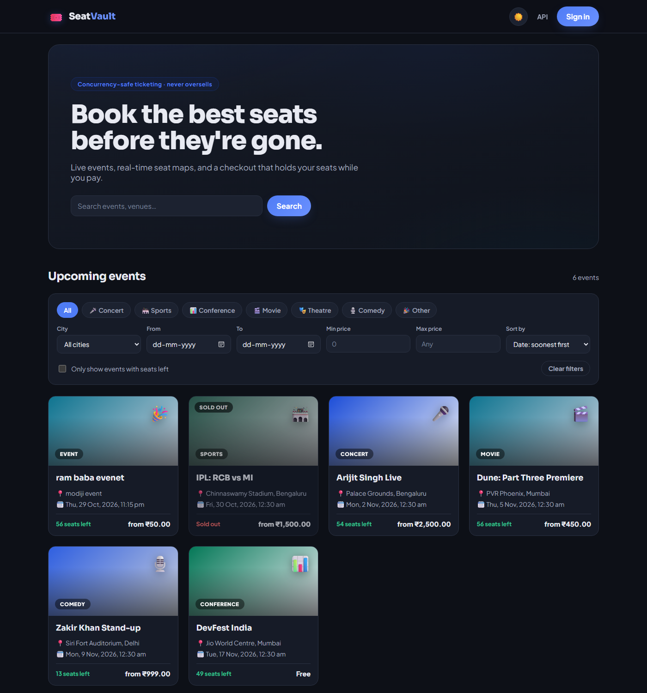
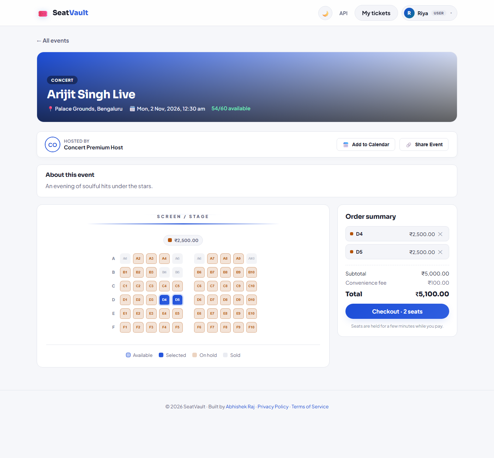
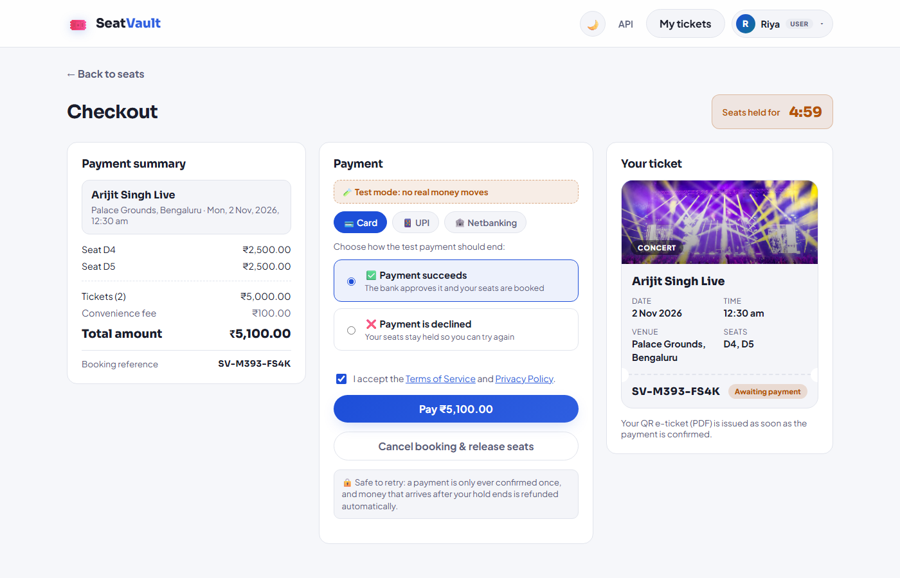
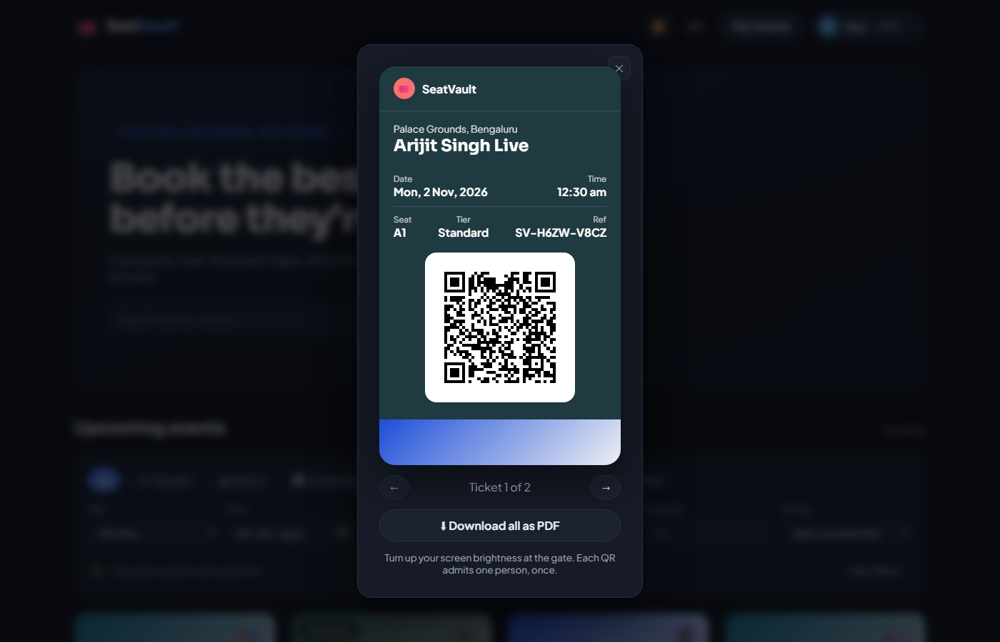
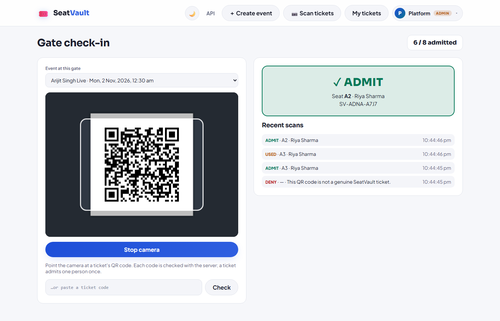
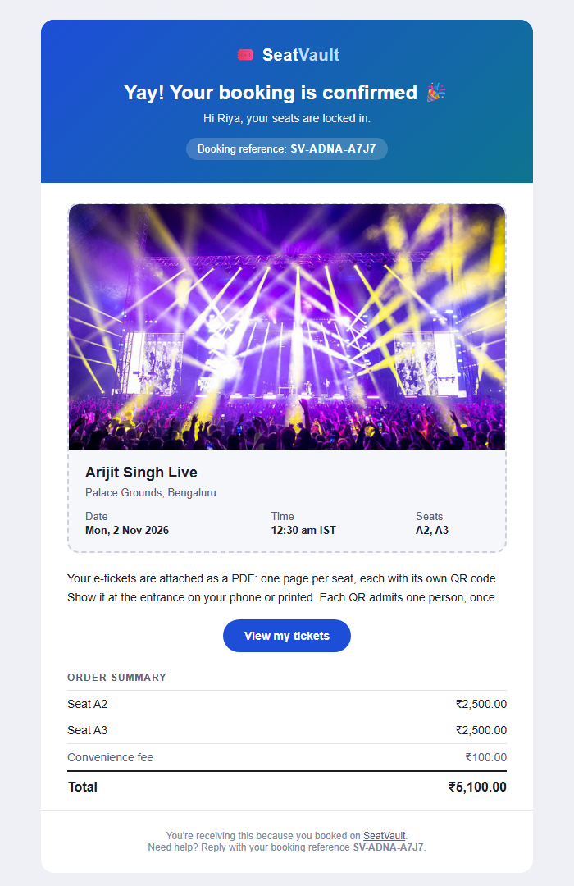

# SeatVault - Enterprise Event Ticket Booking Platform

[](https://github.com/Abhishek360007/SeatVault/actions/workflows/ci.yml)
[](#project-status)
[](https://openjdk.org/projects/jdk/17/)
[](https://spring.io/projects/spring-boot)
[](#code-coverage)

SeatVault is a high-performance, concurrency-safe, enterprise event ticketing platform built with Spring Boot 3, PostgreSQL, Redis, and Vanilla JS. It is designed to handle high-demand ticket drops, zero-overselling guarantees, payment idempotency, virtual waiting rooms, PDF e-ticket generation, gate check-in scanning, and production observability.

## 📸 Screenshots

| Discover events | Dark mode |
| --- | --- |
|  |  |
| **Live seat map** | **Checkout** |
|  |  |
| **QR ticket pass** | **Gate check-in scanner** |
|  |  |

<p align="center">
  <br/>
  <sub>Booking confirmation email (PDF tickets attached)</sub>
</p>


## 🚀 Project Status

> [!NOTE]
> **Status: Production-hardened core, Razorpay checkout ready to switch on**
>
> The booking/concurrency core, security controls, waiting room, checkout, e-tickets
> and CI quality gates below are implemented and covered by tests. Payments run on a
> **simulated** provider by default, which signs its results exactly as Razorpay does,
> so the real verification path runs locally with no account. Set
> `PAYMENT_PROVIDER=razorpay` with test keys to use Razorpay (see [Payments](#-payments)).

- **Concurrency & Locking**: Pessimistic/Optimistic row locking with 0% overselling guarantee under extreme concurrent traffic.
- **High-Demand Virtual Waiting Room**: Redis Sorted Set FIFO queue with periodic admission batching and short-lived, re-checked (not consumed) admission tokens.
- **Checkout & Payments**: Razorpay order-based checkout (UPI, cards, netbanking) with signed callback verification, signed webhooks and a reconciliation sweep, all finishing through one idempotent path; late payments are refunded automatically. Human-readable booking references (`SV-7KX4-92QD`).
- **Email Notifications**: booking confirmation (PDF tickets attached), payment receipt, cancellation, refund and a 24-hour event reminder, through a transactional outbox with SKIP LOCKED dispatch and exponential-backoff retries. Mailpit catches them locally.
- **E-Ticket & Gate Check-in**: OpenPDF document rendering, ZXing QR code generation, and HMAC-SHA256 digital signature verification for gate check-in scanners. Generated on demand at download time (not eagerly at payment confirmation).
- **JWT Security & Token Revocation**: 15-min access tokens, 7-day Redis refresh tokens, token revocation blocklist, and a startup guard that halts boot in `prod` if secrets are left at dev defaults.
- **Rate Limiting & Safety**: IP-based rate limiting on registration, login, event browsing, and waiting-room join; per-user rate limiting on seat holds; hard page-size capping on all pageable queries; a trusted-proxy allowlist so `X-Forwarded-For` can't be spoofed to dodge it.
- **Production Observability**: Prometheus metrics (`/actuator/prometheus`), MDC `X-Request-Id` request tracing, and profile-based JSON logging.
- **CI/CD Quality Gates**: a 40% line-coverage floor enforced via JaCoCo in Maven `verify` (set from measured unit-test coverage, meant to be raised as tests grow — see the comment in `pom.xml`), OWASP Dependency-Check failing the build on CVSS ≥ 7.0, and a Trivy image scan failing on HIGH/CRITICAL CVEs.

---

## 📐 Architecture Overview

```text
                      ┌──────────────────────────────────────────────┐
                      │             Single-Page Application          │
                      │         (HTML5 / CSS3 / Vanilla JS)          │
                      └──────────────────────┬───────────────────────┘
                                             │ REST / JSON
                                             ▼
                      ┌──────────────────────────────────────────────┐
                      │          Spring Boot 3.3 Gateway             │
                      │ ┌──────────────────────────────────────────┐ │
                      │ │ RequestIdFilter (MDC X-Request-Id)       │ │
                      │ │ RateLimitInterceptor (Redis IP Limiter)  │ │
                      │ │ JwtAuthenticationFilter (Token & Revoc)  │ │
                      │ └──────────────────────────────────────────┘ │
                      └──────┬───────────────────────────────┬───────┘
                             │                               │
                             ▼                               ▼
              ┌──────────────────────────────┐┌──────────────────────────────┐
              │     PostgreSQL Database      ││         Redis Cache          │
              │ ┌──────────────────────────┐ ││ ┌──────────────────────────┐ │
              │ │ Flyway Schema Migrations │ ││ │ FIFO Waiting Room ZSET   │ │
              │ │ Events, Seats, Bookings  │ ││ │ Refresh Tokens & Blacklist│ │
              │ │ Payments, Users (BCrypt) │ ││ │ IP Rate Limit Counters   │ │
              │ └──────────────────────────┘ ││ └──────────────────────────┘ │
              └──────────────────────────────┘└──────────────────────────────┘
```

---

## 🌟 Key Features

### 1. High-Demand Virtual Waiting Room (FIFO Queue)
- Flag an event `highDemand: true` on create/update (`EventRequest.highDemand`); non-flagged events skip the queue entirely (join/status report immediately admitted).
- `POST /api/v1/events/{id}/queue/join` adds the caller to a Redis Sorted Set FIFO line (`ZADD NX`, so a repeat join doesn't lose their place).
- `GET /api/v1/events/{id}/queue/status` reports position, or the admission token once admitted.
- `QueueAdmissionScheduler` admits the next batch (`app.waiting-room.admission-batch-size`, default 50) every `admission-interval-ms` (default 10s).
- `POST /api/v1/bookings/hold` requires a valid `admissionToken` for high-demand events; the token is TTL-bound (default 120s) and re-checked (not consumed) on every attempt, so a lost seat race doesn't force re-queueing.
- API-only for now — the SPA doesn't yet have a waiting-room UI.

### 2. E-Ticket PDF & Gate Check-in Verification
- `GET /api/v1/bookings/{id}/ticket` (owner or admin) renders a PDF on demand — OpenPDF, one page per seat — via `TicketService`.
- Each page embeds a ZXing QR code encoding an HMAC-SHA256 signed token: `<base64url(bookingId|seatId|eventId|issuedAt)>.<base64url(signature)>`.
- `POST /api/v1/tickets/verify` (accessible by `ADMIN` / `SCANNER` roles) verifies the signature, checks the booking is `CONFIRMED` and the seat is `BOOKED`, and records the check-in. A tampered signature is rejected with 400; a re-scan of an already-checked-in seat returns `alreadyCheckedIn: true` instead of erroring (a scanner can safely re-verify).
- Check-ins are durable (`ticket_checkins` table, unique per seat) so a duplicate scan can't be recorded twice even under concurrent scanners.
- There is currently no API to provision `SCANNER` accounts — promote a user's role directly in the database until an admin user-management endpoint exists.

### 3. Concurrency & Idempotency Guarantees
- **Zero Overselling**: Row locks (`SELECT FOR UPDATE` or optimistic retry) guarantee exactly one user holds a seat.
- **Idempotent Payment**: Unique `(booking_id, idempotency_key)` constraint prevents double-charging.
- **Hold Expiry**: Scheduled `HoldReleaseService` releases abandoned holds after 5 minutes.

### 4. JWT Authentication & Token Management
- Short-lived JWT access tokens (15 mins) and long-lived opaque refresh tokens (7 days stored in Redis).
- `POST /api/v1/auth/refresh` exchanges refresh tokens for new access tokens.
- `POST /api/v1/auth/logout` revokes refresh tokens and blocklists the active access token JTI in Redis.

### 5. Production Hardening & Safety
- **Startup Guard**: `ProductionSecurityValidator` halts boot in the `prod` profile if `ADMIN_PASSWORD` is `admin12345`, or `JWT_SECRET`/`TICKET_HMAC_SECRET` are missing or still contain `change-me`.
- **IP Rate Limiting**: Redis atomic Lua script limits registration, login, event browsing, and waiting-room join; `ClientIpResolver` only trusts `X-Forwarded-For` from an operator-configured `app.security.trusted-proxies` allowlist (empty by default — the header is ignored on a directly-exposed instance).
- **Query Capping**: Enforces a hard limit (`spring.data.web.pageable.max-page-size: 100`) on all Pageable endpoints.
- **Observability**: Prometheus metrics at `/actuator/prometheus`, MDC `X-Request-Id` tracing, custom metrics (`seat.hold.count`, `payment.count`).

---

## 🛠️ Tech Stack

| Layer | Technology |
| --- | --- |
| **Language & Runtime** | Java 17, Spring Boot 3.3.1 |
| **Database** | PostgreSQL 16, Flyway 10 |
| **Caching & Queue** | Redis 7 (Sorted Sets, String TTLs, Atomic Lua) |
| **Security** | Spring Security 6, JJWT 0.12, BCrypt |
| **PDF & QR Code** | OpenPDF 1.3, ZXing 3.5 |
| **Metrics & Tracing** | Micrometer, Prometheus, Logstash Logback JSON |
| **Testing** | JUnit 5, Mockito, Testcontainers, JaCoCo |
| **CI/CD** | GitHub Actions, OWASP Dependency-Check, Trivy Security Scanner |

---

## 📡 Key REST Endpoints

### Authentication & Tokens
| Method | Endpoint | Access | Description |
| --- | --- | --- | --- |
| `POST` | `/api/v1/auth/register` | Public | Register new user account |
| `POST` | `/api/v1/auth/login` | Public | Authenticate & receive access + refresh token |
| `POST` | `/api/v1/auth/refresh` | Public | Refresh expired access token |
| `POST` | `/api/v1/auth/logout` | Authenticated | Revoke refresh token & blocklist access token |

### Events & Waiting Room
| Method | Endpoint | Access | Description |
| --- | --- | --- | --- |
| `GET` | `/api/v1/events` | Public (IP rate limited) | List/search upcoming events |
| `GET` | `/api/v1/events/{id}` | Public (IP rate limited) | Event details |
| `GET` | `/api/v1/events/{id}/seats` | Public (IP rate limited) | Live seat map status |
| `POST` | `/api/v1/events/{id}/queue/join` | Authenticated (IP rate limited) | Join the virtual waiting room (no-op if event isn't high-demand) |
| `GET` | `/api/v1/events/{id}/queue/status` | Authenticated | Poll queue position / admission token |
| `POST` | `/api/v1/events` | Admin | Create event with seat grid / tiers / `highDemand` flag |
| `PUT` | `/api/v1/events/{id}` | Admin | Update event metadata (seating immutable) |
| `DELETE` | `/api/v1/events/{id}` | Admin | Delete an event (fails if it has bookings) |

### Bookings & E-Tickets
| Method | Endpoint | Access | Description |
| --- | --- | --- | --- |
| `POST` | `/api/v1/bookings/hold` | Authenticated (rate limited) | Hold seats (requires `admissionToken` if the event is high-demand) |
| `POST` | `/api/v1/bookings/{id}/checkout` | Authenticated | Open (or reuse) the provider order for a pending booking |
| `POST` | `/api/v1/bookings/{id}/payments/verify` | Authenticated | Verify the provider's signed success callback and confirm (idempotent) |
| `POST` | `/api/v1/bookings/{id}/payments/failure` | Authenticated | Record a failed attempt reported by the widget (display only) |
| `POST` | `/api/v1/payments/webhook/razorpay` | Public, HMAC-signed | Provider webhook (`payment.captured`, `payment.failed`, `order.paid`) |
| `POST` | `/api/v1/payments/simulated/checkout` | Authenticated, simulated mode only | Stand-in for the provider widget in test mode |
| `POST` | `/api/v1/bookings/{id}/pay` | Authenticated | Direct server-side charge (simulated provider only; idempotent by key) |
| `POST` | `/api/v1/bookings/{id}/cancel` | Authenticated | Cancel a pending booking, release its held seats |
| `GET` | `/api/v1/bookings/{id}/ticket` | Owner/Admin | Download the PDF e-ticket (confirmed bookings only) |
| `GET` | `/api/v1/bookings/{id}/passes` | Owner/Admin | On-screen tickets: one signed QR per seat, with check-in status |
| `POST` | `/api/v1/tickets/verify` | Admin/Scanner | Verify a scanned QR token for this gate's `eventId` and record the check-in |
| `GET` | `/api/v1/tickets/summary?eventId=` | Admin/Scanner | Tickets sold vs. admitted, for the gate screen |

## 💳 Payments

Booking states: `PENDING → CONFIRMED | EXPIRED | CANCELLED` (enforced in `Booking`; terminal states are final).

1. **Hold** seats → a `PENDING` booking with a frozen price and a booking reference.
2. **Checkout** opens one provider order per booking (reused on retry), for the frozen amount.
3. The customer pays in **Razorpay's own widget**; card/UPI details never reach SeatVault.
4. The server **verifies the signed callback**, asks Razorpay for the payment's real state, and confirms.
   The **webhook** and a **reconciliation sweep** deliver the same result if the tab is closed.
   All three end in `CheckoutService.complete`, which confirms exactly once.
5. If money arrives after the hold expired or the booking was cancelled, it is **refunded** in full
   instead of confirming seats that may now belong to someone else.

### Using Razorpay test mode

1. Create a Razorpay account and switch the dashboard to **Test Mode**.
2. Under *Account & Settings → API Keys*, generate a test key, and put it in your local `.env`
   (never commit it):
   ```bash
   PAYMENT_PROVIDER=razorpay
   RAZORPAY_KEY_ID=rzp_test_xxxxxxxxxxxx
   RAZORPAY_KEY_SECRET=xxxxxxxxxxxxxxxxxxxx
   RAZORPAY_WEBHOOK_SECRET=choose-a-long-random-string
   ```
3. Optional locally (required in `prod`): add a webhook in *Settings → Webhooks* pointing to
   `https://<public-host>/api/v1/payments/webhook/razorpay` with events `payment.captured`,
   `payment.failed` and `order.paid`, and the same secret. Locally, expose port 8080 with a
   tunnel (e.g. `ngrok http 8080`); without it, payments are still confirmed from the browser
   callback and the reconciliation sweep.
4. Pay with Razorpay's [test cards / UPI IDs](https://razorpay.com/docs/payments/payments/test-card-details/).

## 🎫 QR tickets & gate check-in

- Each seat gets its own QR holding an **HMAC-SHA256-signed token** (`bookingId|seatId|eventId|issuedAt`).
  Editing any part breaks the signature, so ticket IDs can't be forged or guessed.
- Customers see wallet-style passes under **My tickets → Show tickets**, or download the PDF (one page per seat).
- Staff with the `ADMIN` or `SCANNER` role open **📷 Scan tickets**, pick the event at their gate and scan
  with the camera (native `BarcodeDetector`, or the bundled jsQR elsewhere) or paste a code.
  The server checks the signature, **that the ticket is for this event**, that the booking is confirmed,
  and records the check-in under a unique constraint, so each seat is admitted **once**, even with
  simultaneous scans. A re-scan shows **ALREADY USED** with when and by whom.
- Cameras need a secure context: `localhost` works; on a phone, serve the app over HTTPS.

## ✉️ Email notifications

Booking changes write an email row to the `notifications` outbox **in the same transaction**, so an email
exists exactly when the change commits. A dispatcher claims due rows with `FOR UPDATE SKIP LOCKED`
(safe across instances), sends them over SMTP outside any transaction, and retries failures after
30s, 1m, 2m ... up to 1h, marking them `FAILED` after 8 attempts or on a permanent error.
Emails are rendered from Thymeleaf templates in `src/main/resources/templates/email`.

Locally, run `docker compose up -d mailpit` and open **http://localhost:8025** to read every email
SeatVault sends; nothing leaves your machine. In production, point `MAIL_HOST`, `MAIL_PORT`,
`MAIL_USERNAME`, `MAIL_PASSWORD` (with `MAIL_SMTP_AUTH=true`, `MAIL_STARTTLS=true`) at your provider's
SMTP relay and set `MAIL_FROM` and `APP_PUBLIC_BASE_URL`.

### Observability
| Method | Endpoint | Access | Description |
| --- | --- | --- | --- |
| `GET` | `/actuator/prometheus` | Public/Ops | Micrometer Prometheus metrics |
| `GET` | `/actuator/health` | Public | Spring Boot health check |

---

## ☁️ Deploy to Render

[`render.yaml`](render.yaml) is a Render Blueprint: one file that creates the app, a PostgreSQL
database and a Redis instance (all free tier, Singapore region) and wires them together.

1. Sign in at [render.com](https://render.com) with GitHub.
2. **New → Blueprint**, pick this repository, and click **Apply**.
3. When asked for `ADMIN_PASSWORD`, enter a strong password (12+ characters). The admin login
   is `admin@seatvault.local` with that password.
4. Wait for the first deploy (the Docker build takes a few minutes). The app is then live at
   `https://<service-name>.onrender.com`, with HTTPS, so the gate scanner's camera works on phones.

Render generates `JWT_SECRET`, `TICKET_HMAC_SECRET` and `PAYMENT_SIMULATED_SECRET` itself, and
every push to `main` redeploys automatically.

**Free-tier limits:** the app sleeps after 15 minutes without visitors (the next visit takes about a
minute to wake it), it has 512 MB of memory (the JVM is tuned for that in `render.yaml`), and the free
database is **deleted 30 days after creation** unless you upgrade it (Render emails you before).

**Turning on email:** create a free SMTP account, e.g. [Brevo](https://www.brevo.com) (300 emails/day),
then in the Render dashboard → *seatvault* → *Environment* set:

| Variable | Value |
| --- | --- |
| `NOTIFICATIONS_ENABLED` | `true` |
| `MAIL_HOST` | `smtp-relay.brevo.com` |
| `MAIL_PORT` | `587` |
| `MAIL_USERNAME` / `MAIL_PASSWORD` | your Brevo SMTP login and key |
| `MAIL_SMTP_AUTH` / `MAIL_STARTTLS` | `true` / `true` |
| `MAIL_FROM` | `SeatVault <a sender address verified in Brevo>` |

**Real payments:** add `PAYMENT_PROVIDER=razorpay` and the Razorpay variables from [Payments](#-payments).

## 🧪 Testing & Code Quality

### Running Unit Tests
```bash
./mvnw clean test
```

### Running Full Integration Tests (Testcontainers Postgres + Redis)
```bash
./mvnw clean verify
```
*Note: JaCoCo enforces a minimum **40% line coverage** floor on the build during `mvn verify` (measured from unit tests alone; integration tests add more in CI). This is a floor, not a target — raise it as coverage grows.*

---

## 👤 Author
**Abhishek Raj** — [GitHub @Abhishek360007](https://github.com/Abhishek360007) · abhiraj360007@gmail.com

---

## 📄 License
This project is licensed under the MIT License — see [LICENSE](LICENSE).
